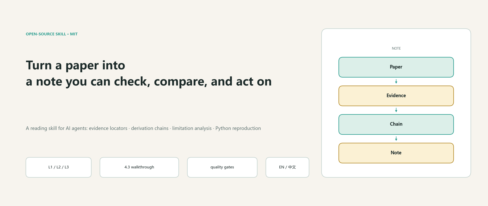
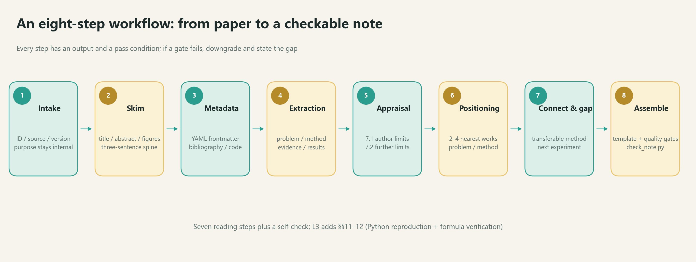
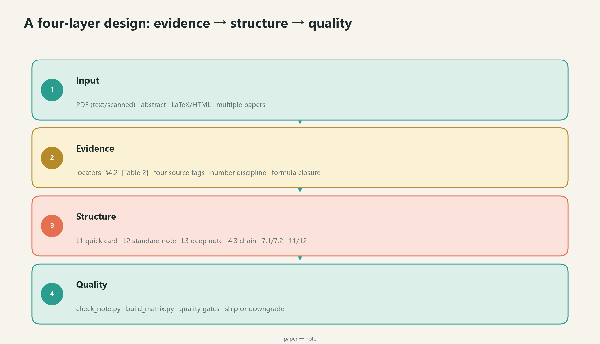
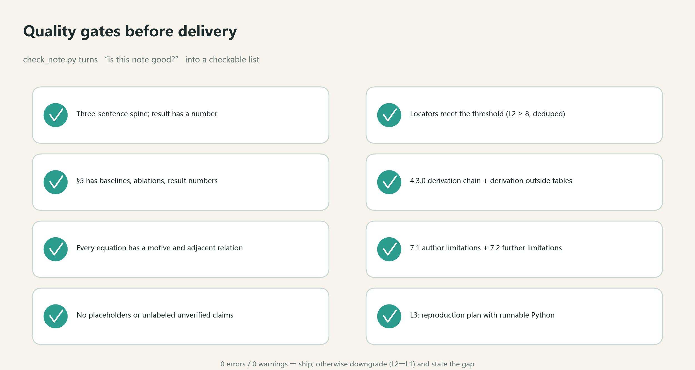

# Paper Reading Note

> Turn a paper into a note you can **check**, **compare**, and **act on** — not a longer abstract.

[](CHANGELOG.md)
[](LICENSE)
[](en/README.md)

**English** · [中文](zh/README.md) · [WeChat article (Chinese)](docs/wechat-article.md)



## Why this exists

Most AI-generated reading notes fail in the same four ways:

| Failure | What it looks like | What this skill does instead |
|---|---|---|
| Abstract paraphrase | "The authors propose a novel method with strong results." | Every key claim carries a locator: `[§4.2]`, `[Table 2]`, `[p.7]` |
| Method missing | Conclusions only, no equations or data splits | Reproducible method details plus a **4.3 equation walkthrough** |
| Praise without critique | Repeats the authors' limitations | First restates the authors' limitations, then adds **further limitations** |
| Read and forgotten | No connection to your own work | Explicit transferable method, reusable metrics, next experiment, gaps |

## What you get

A fixed-structure reading note with three depth levels:

| Level | Output | Time | Use when |
|---|---|---|---|
| **L1** | Quick-read card | 10–15 min | Decide whether a paper is worth a deep read |
| **L2** | Standard note | 45–90 min | The default: understand and archive a paper |
| **L3** | Deep note | 2–4 h | Reproduce the paper or write about it |

An L2 note contains: field guide, at-a-glance summary, metadata, problem definition, related work, method, **4.3 equation walkthrough**, experiments and evidence, main findings, **7.1 author limitations → 7.2 further limitations**, relation to your research, research gaps, key quotations, and a terminology appendix.

L3 adds a **reproduction plan with runnable Python** and a **formula/derivation verification** section.



## Design principles

- **Evidence first.** No claim without a locator; the four source tags `[Original]`, `[Inference]`, `[External: source]`, `[Question]` keep evidence and judgment apart.
- **Formulas are a chain, not a list.** `4.3.0` gives the derivation chain (what each equation leaves unsolved and why the next one exists); each equation then gets meaning, symbols, motive, origin, assumptions, and a derivation written outside the table.
- **Critique without scores.** No 8-dimension rubric and no confidence rating. Restate what the authors acknowledge, then add what they missed, with evidence and a way to test it.
- **A quality gate, not a vibe check.** `check_note.py` verifies structure, locator counts, result numbers, baseline/ablation coverage, formula chain, limitation structure, and L3 code.
- **Safe by default.** If only an abstract is available, the note is forced to L1; unreadable sections are marked as gaps instead of invented.



## Repository layout

```text
paper-reading-note/
├── en/                       # English skill (SKILL.md, README, references, templates, scripts, example)
├── zh/                       # 中文版 skills（同样的结构，中文内容）
├── docs/
│   ├── wechat-article.md     # Chinese WeChat article
│   ├── make_figures.py       # script that generates all diagrams
│   └── images/               # PNG diagrams used by READMEs and the article
├── CHANGELOG.md
├── LICENSE
└── README.md
```

Each language directory is a **self-contained skill**: `SKILL.md`, a language README, five reference documents, five templates, two scripts, and a worked example.

## Install

### Claude Code (personal)

```bash
cp -r en ~/.claude/skills/paper-reading-note        # English
cp -r zh ~/.claude/skills/paper-reading-note-zh     # Chinese
```

### Claude Code (project)

```bash
cp -r en .claude/skills/paper-reading-note
```

### Codex / DSH / OpenCode / other SKILL.md-aware tools

Copy `en/` or `zh/` into the tool's skills directory, or simply give the agent the path to `SKILL.md` and ask it to read the skill before reading the paper.

### No install

```text
Read en/SKILL.md first, then write a paper reading note for papers/attention.pdf
following its L2 workflow.
```

## Quick start

```text
Read papers/attention.pdf and write a standard L2 paper reading note.
Run the skill's check_note.py on the notes directory when done.
```

L3:

```text
Read papers/attention.pdf at L3:
explain each equation and its intellectual origin in §4.3,
restate the authors' limitations then add further limitations in §7,
provide runnable Python in §11, and verify the derivations in §12.
```

Or ask for the other modes: L1 quick-read card, multi-paper comparison matrix, synthesis note, research-gap analysis.

## Check a note

```bash
python en/scripts/check_note.py notes/
python en/scripts/check_note.py notes/ --strict
python en/scripts/check_note.py notes/ --abstract
python en/scripts/build_matrix.py notes/ -o notes/matrix.md --csv notes/matrix.csv
```

Exit codes: `0` pass, `1` check failed (or warnings under `--strict`), `2` path/parameter error.
The scripts are standard-library only; Python 3.9+ is enough.

## Worked example

[`en/examples/vaswani2017-attention.md`](en/examples/vaswani2017-attention.md) is a full L2 note for *Attention Is All You Need*: field guide, equation chain, per-equation derivations, author/further limitations, terminology appendix, and research connection.

The Chinese skill ships with the same example translated: [`zh/examples/vaswani2017-attention.md`](zh/examples/vaswani2017-attention.md).

## Verification

Both bundled examples are self-checked in the repository:

```bash
python en/scripts/check_note.py en/examples --strict
python zh/scripts/check_note.py zh/examples --strict
```

Expected: `0 errors, 0 warnings`. The English checker reports `28` unique locators and `9` result values in §5 for the example; the Chinese checker reports the same.

## Quality gates at a glance



## Documentation and languages

- [English skill](en/README.md)
- [中文版 skill](zh/README.md)
- [WeChat article (Chinese, with diagrams)](docs/wechat-article.md)

## License

MIT. See [LICENSE](LICENSE).
