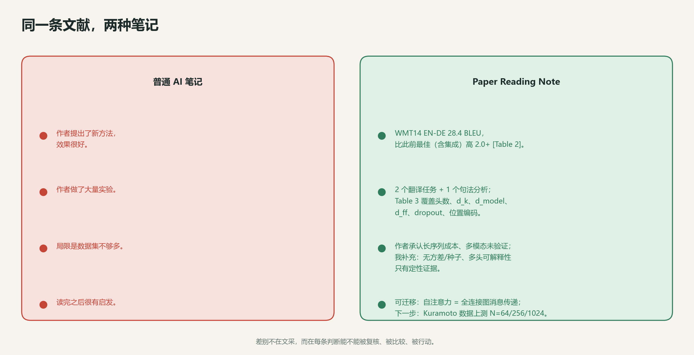
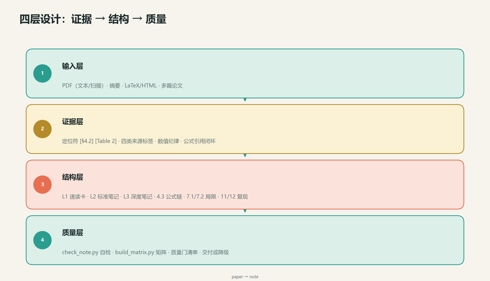
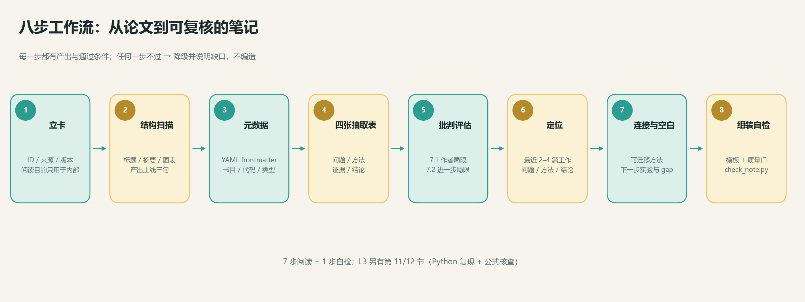
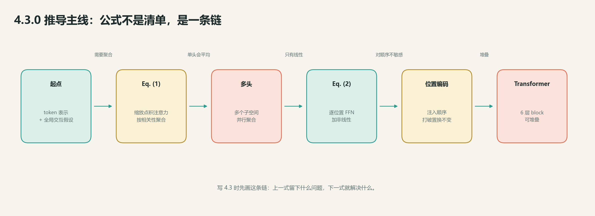
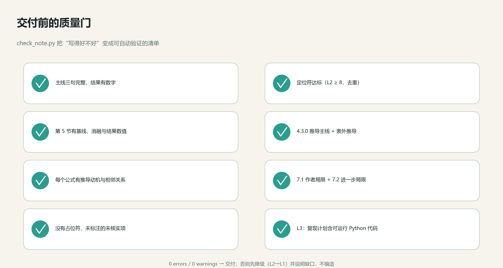

# 读完论文就忘？我让 AI 用一套 Skill 写出「可复核」的阅读笔记

> 一个开源的论文精读 Skill：证据定位、公式推导链、作者/进一步局限、L3 Python 复现，以及一套能自动跑的 quality gate。
>
> 项目地址：`https://github.com/<your-name>/paper-reading-note`（发布时替换）


## 一、AI 读论文，为什么总像在写「更长的摘要」

让大模型读一篇论文，它通常能写得很顺：

> 本文提出了一种新方法，有效解决了某问题，实验表明性能显著提升。

但如果你过两周再回来看，会发现几乎没法用。它没有告诉你：

- 这个结论来自哪张表、哪一节？
- 方法的关键公式是什么？为什么这么设计？
- 作者自己承认了什么局限？还有哪些作者没说？
- 这篇论文和我的研究到底有什么关系？
- 如果我要复现，第一步该跑什么？

问题不在「写得不够多」，而在**笔记没有可复核的结构**。一篇好的文献笔记，应该像一份可执行的工程文档：每个判断有出处，每个公式有推导，每个局限有证据，每个下一步能落地。

这就是我开源 **Paper Reading Note** 的起点。



## 二、它不是一个 prompt，而是一套完整 Skill

仓库里有两个语言版本，结构完全一致：

- `zh/`：中文版 Skill
- `en/`：English skill

每个版本都是自包含的：`SKILL.md`、README、5 份参考文档、5 个模板、2 个脚本，以及一篇填好的示例笔记。

当前版本 **v1.3.11**，核心是一句话：

> 把论文读成**可复核、可比较、可行动**的笔记，而不是一篇更长的摘要。



它的设计可以拆成四层：

1. **输入层**：PDF（文本/扫描）、摘要、LaTeX/HTML、多篇论文；
2. **证据层**：定位符、四类来源标签、数值纪律、公式引用闭环；
3. **结构层**：L1/L2/L3 三档深度、4.3 公式详解、7.1/7.2 局限分析、11/12 复现与核查；
4. **质量层**：`check_note.py` 自检 + `build_matrix.py` 矩阵 + 人工质量门。

## 三、七步阅读 + 一步自检：把「读论文」拆成可检查的动作



1. **立卡**：生成 paper_id，记录来源、版本、页数；阅读目的只用于内部决策，不写进笔记。
2. **结构扫描**：只读标题、摘要、引言末尾、图表标题、结论、附录标题，先写出「问题—做法—结果」主线三句。
3. **元数据**：抽取作者、机构、年份、发表处、DOI、代码/数据链接，写成 YAML frontmatter。
4. **四张抽取表**：问题表、方法表、证据表、结论表。每行都要能定位。
5. **批判性评估**：先复述作者承认的局限，再补「进一步的局限」，不评分、不设置信度。
6. **定位**：找 2–4 篇最接近的工作，用「问题/方法/结论」三维定位。
7. **连接与空白**：可迁移的方法、可复用的数据/指标、要避开的问题、下一步实验、研究空白。
8. **组装与自检**：套模板，过质量门，跑 `check_note.py`，通过才交付。

关键在最后一步：**不是「我觉得写完了」，而是「脚本说它合格」。**

## 四、三个我最有感触的设计

### 1. 每个论断都要有定位符

Skill 强制使用这样的写法：

```text
WMT14 EN-DE 28.4 BLEU，比此前最佳（含集成）高 2.0+ [原文][Table 2]。
```

同时用四类标签区分知识来源：

- `[原文]`：论文明确写了；
- `[推断]`：我基于证据的推理；
- `[外部: 来源]`：论文之外的知识，必须给来源；
- `[疑问]`：还没读懂或待核实。

这样，读者一眼就能看出：哪些是作者说的，哪些是笔记作者自己的判断。

### 2. 公式不是清单，而是一条推导链

这是 v1.3 系列改动最大的地方。很多笔记会把公式逐条抄一遍，但读者仍然不知道：

> 这些公式之间是什么关系？作者为什么会想到推出下一式？

所以模板里增加了 **4.3.0 推导主线**：



先写清楚「目标 → 起点 → 每一步为什么必须引入 → 得到什么 → 下一步为什么能接上」，再用一张表把链条固定下来：

| 步骤 | 出发点 | 这一步要解决什么 | 得到的公式 | 为下一步提供什么 |
|---|---|---|---|---|
| 1 | token 表示 + 全局交互 | 如何按相关性聚合全序列 | Eq. (1) 注意力 | 上下文表示 |
| 2 | Eq. (1) 的单头输出 | 单头会平均掉多种关系 | 多头注意力 | 多子空间表示 |
| 3 | 多头输出 | 缺少逐 token 非线性 | Eq. (2) FFN | 非线性特征 |
| 4 | 注意力 + FFN | 对位置置换不变 | 位置编码 | 完整 Transformer block |

每个公式还要写清楚「推导动机、思想来源、作用、假设、与相邻公式的关系」，并在表格外给出完整推导：起始式要说明是定义、公认事实、前文结论还是论文假设；每一步要交代用了哪条公式、做了什么操作；不能只写「由 Eq. X 得 Eq. Y」。

这部分后来还长出了很多细节规则：复合式先给最简情形、关键判断给最小机制、线性化写出 Taylor 展开、推导用论文式语体、写完做语病检查……这些规则看起来很「苛刻」，但正是它们把笔记从「能看懂」推进到「能复核」。

### 3. 批判性评估：先复述作者，再补充自己

很多 AI 笔记的「局限」部分，其实是把作者的 limitation 换个说法再写一遍。这个 Skill 明确要求分两层：

- **7.1 作者承认的局限（复述）**：作者在 limitation/discussion/假设/未来工作中明确写出的内容，逐条转述并标定位；
- **7.2 进一步的局限（我补充）**：作者没有承认、但从证据/设计/假设/外部有效性/可复现性可以指出的问题，每条写「现象 + 证据 + 影响 + 如何验证」。

同时明确**不评分、不设置信度**。批判的价值不在于给论文打 8 个维度的分数，而在于指出「在什么条件下成立、在什么条件下不成立」。

### 4. 把「好推导」拆成可检查的细则

v1.3.1 到 v1.3.11 的十几次迭代，几乎都在做同一件事：把「推导要写清楚」这种模糊要求，拆成可执行的规则。

- **公式引用闭环**：引用 `Eq. (x)` 时，如果该式还没在笔记里出现过，就在引用处把公式写出来；范围引用 `Eq. (A4)–(A12)` 只保留已经展示过的编号。
- **表外推导**：每个公式表格下方，写从「推导动机 / 思想来源」到目标公式的完整推导；表格里的动机可以精简成一句话。
- **推导不跳步**：每一步要交代用了哪条原始公式、做了什么操作（代入/展开/平均/分部积分/取极限）；移项、合并同类项等基础代数不必展开，但「由 Eq. X 得 Eq. Y」不行。
- **起始式标来源**：初始表达式要说明它是定义、公认事实/守恒律、前文结论（Eq. x）还是论文假设；复合式先写最简情形，再说明新增项。
- **关键判断给机制**：遇到「唯有…才…」「必然…」「等价于…」这类判断，按「判断 → 1–3 式最小机制 → 一句直觉 → 边界」写；如果用了线性化，要写出 Taylor 展开（一阶项 + 余项）。
- **推导语体与语病**：用论文式陈述（设/令/由…得/于是/故），不写「这一步的必要性」「不构成循环论证」这类元话语；写完后逐句检查主语、搭配、赘余、逻辑重复和指代。

这些规则听起来很细，但它们解决的是同一个问题：**读者能不能顺着你的笔记，把推导自己复述一遍。**

## 五、L3：把「复现」写进笔记

L2 已经能覆盖大多数阅读场景；如果目标是复现或写论文，就进入 L3。

L3 追加两节：

- **11 复现计划**：环境、参数表、**可运行的 Python 代码**、运行命令、验收标准、证伪条件、已知缺口；
- **12 公式与推导核查**：符号/量纲表、逐步核对、勘误记录、遗留疑点。

复现代码不是伪代码：脚本会检查第 11 节是否包含 ` ```python ` 代码块、是否有 `import`/`def`、是否还留着 `NotImplementedError` 占位。

另外两个容易被忽略、但很影响可读性的要求：

- **领域导读**：L2/L3 要在 §0 前用 2–3 段介绍「这个领域在做什么、问题分哪几层、本文补哪一层」，写给不熟悉该领域的读者；
- **术语与图表**：读者可以用 `<u>术语</u>$^{[n]}$` 标出不懂的名词，Agent 在「附录 1：术语解释」按编号解释；原文图从 PDF 裁切后存 `notes/figures/`，一图一行居中，图注标图号与页码。

## 六、质量门：让「写得好不好」变成可执行的检查



`check_note.py` 会检查：

- 必填章节（L1/L2/L3 不同）；
- 去重后的定位符数量；
- 第 5 节的结果数值、基线、消融/对照关键词；
- 4.3.0 推导主线、每个公式的推导动机与相邻关系、表外推导；
- 7.1/7.2 局限结构；
- L3 复现代码；
- 占位符残留、公式渲染、术语标记与附录对应关系。

它不能判断「这篇论文的结论是否正确」，但能保证：**笔记没有偷工减料，没有假装读过，没有把作者的话当成自己的判断。**

## 七、怎么用

### 安装

```bash
# Claude Code（个人技能）
cp -r en ~/.claude/skills/paper-reading-note
cp -r zh ~/.claude/skills/paper-reading-note-zh

# 或者直接用路径让 Agent 先读 SKILL.md
```

### 单篇精读

```text
读 papers/attention.pdf，按 paper-reading-note 的 L2 流程写阅读笔记，
输出到 notes/attention.md，并用 check_note.py 检查 notes/ 目录。
```

### L3 深度笔记

```text
读 papers/attention.pdf，按 L3 写：
4.3 逐公式解释含义与思想来源，7.1 复述作者局限、7.2 补进一步局限，
11 给出可运行的 Python 复现代码，12 核查推导。
```

### 多篇对比

```text
把 notes/ 下这 6 篇关于 X 的论文做成对比矩阵，再写综述：
问题谱系、方法族与共识、分歧及原因、趋势、研究空白。
每条判断标注来自哪几篇。
```

### 自检

```bash
python en/scripts/check_note.py notes/ --strict
python en/scripts/build_matrix.py notes/ -o notes/matrix.md --csv notes/matrix.csv
```

## 八、仓库里有什么

```text
paper-reading-note/
├── en/                       # English skill
├── zh/                       # 中文版 skill
├── docs/
│   ├── wechat-article.md     # 这篇文章
│   ├── make_figures.py       # 生成所有配图
│   └── images/               # 流程图、架构图、公式链、质量门
├── LICENSE
└── README.md
```

每个语言目录都包含：

- `SKILL.md`：主文件；
- `references/01–05`：抽取、批判、综述、证据规范、复现代码；
- `templates/`：L1 速读卡、L2 标准笔记、L3 复现计划、对比矩阵、综述；
- `scripts/`：自检与矩阵生成；
- `examples/`：一篇填好的 Attention 论文 L2 笔记。

## 九、适合谁，不适合谁

**适合：**

- 需要长期积累文献笔记的研究生、研究者；
- 想用 AI 辅助精读，但不想得到「更长的摘要」的人；
- 需要做多篇对比、写综述、找 research gap 的人；
- 想复现论文、需要把方法和参数固定下来的人。

**不适合：**

- 只想快速知道论文讲了什么（用普通摘要即可）；
- 想让 AI 代写论文或伪造数据（Skill 明确禁止）；
- 不愿花 45–90 分钟认真读一篇论文的人。

## 十、最后

这套 Skill 不是为了让 AI「替你读论文」，而是为了让 AI 帮你**把读过的论文变成可复用的资产**。

它不会让你立刻读懂一篇论文，但会让你在三个月后还能回答：

> 这篇论文的结论是什么？证据在哪？方法为什么这么设计？局限是什么？我当时打算怎么用它？

如果这套工作流对你有帮助，欢迎在 GitHub 上试用、提 issue，或者把它改成适合你所在领域的版本。

> 项目地址：`https://github.com/<your-name>/paper-reading-note`
>
> License: MIT

---

*配图由 `docs/make_figures.py` 生成；文中示例来自仓库中的 Attention L2 笔记。*
