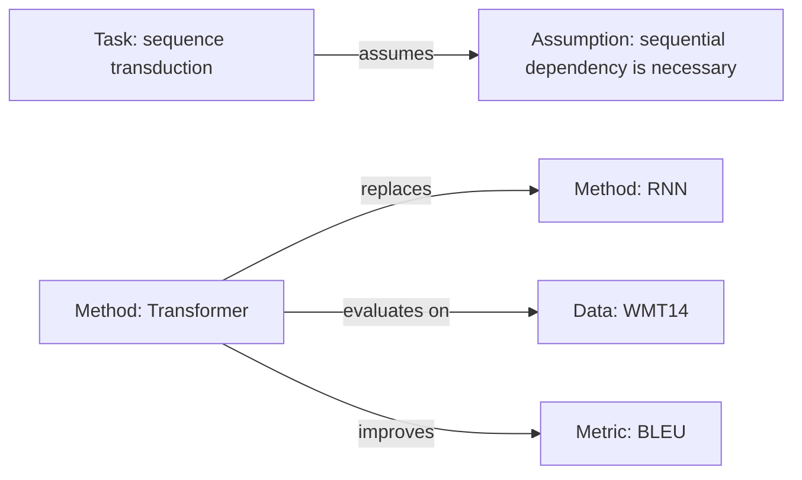

# 01 Extraction Prompts and Question Checklist

> Usage: advance section by section while reading; write every extraction result as a four-tuple `conclusion | number | locator | tag`.
> This file is also the copyable prompt library for the 12 capabilities described in the introduction. Take what you need; you do not have to read it in full every time.

## 1. General Extraction Conventions

1. **Locate before extracting**: when you hit a claim, first record where it is (`§` / `p.` / `Table` / `Fig` / `Eq.` / `L`), then write the content.
2. **One row per fact**: each row of an extraction table holds a single fact or judgment; avoid long paragraphs.
3. **Numbers verbatim**: copy the paper's precision; keep relative and absolute gains separate; state the unit, dataset and metric in full.
4. **Mark uncertainty**: write `[Question]` or "not reported" for content you cannot read or verify; do not fill gaps from common knowledge.
5. **Separate fact from interpretation**: `[Original]` means the paper says it; `[Inference]` means I inferred it from the evidence; `[External: source]` means it comes from outside the paper.
6. **Equation-number closure**: before citing `Eq. (x)` or an appendix equation number, confirm that the equation already appears in the note; if not, write it out at the point of citation. For range citations, keep only the numbers already shown.
7. **Derivation register and proofreading**: write derivations as paper-style statements ("Let / Set / From … we obtain / hence / therefore"); no pedagogical step numbering and no meta-commentary. After writing, check each sentence for missing subjects, wrong collocation, redundancy, logical repetition and unclear references.
8. **Field guide**: before drafting the body, use 3 questions to explain the field clearly: what the field studies, how many layers of problems it has, and which layer this paper fills. Write this as 2–3 paragraphs of guide before §0; a hand-drawn schematic is optional.
9. **No skipped steps in derivations**: give the source equation each step relies on and state the operation performed (substitution/expansion/averaging/integration/limit). Basic algebra such as moving terms and combining like terms need not be expanded, but "from X we obtain Y" must state its basis.
10. **Label the source of the starting expression**: when giving an initial expression, state its nature — definition, accepted fact/conservation law, previous conclusion (Eq. x), or paper assumption. For composite expressions, give the simplest case first (e.g. free running), then explain why the added term (e.g. $+\Delta f$) is introduced.
11. **Key claims get a mechanism**: for judgments such as "only … is stable", "necessarily", "equivalent", give a minimal mechanism in 1–3 equations + one plain-language intuition + the boundary. Do not write a full proof, and do not only state the conclusion. For linearization, write the Taylor expansion (first-order term + remainder).
12. **Reader markers and Appendix 1**: readers mark unfamiliar terms as `<u>term</u>$^{[n]}$` to ask the Agent to explain them in Appendix 1. Keep the marks and numbering, and write one entry per number at the end of the note with "definition + role + distinction", 2–4 sentences each.
13. **Explain axes before meaning**: before a figure, state what the horizontal and vertical axes are (variable + unit/range), what each line/region/colour/symbol means, and one sentence on what the figure shows; do not drop a figure without explanation.
14. **Symbol table first**: put a single symbol table after the field guide and before §0 (meaning + dimension + normalization); symbols covered by the table need only a one-sentence role statement at first appearance; symbols not in the table are defined where they first appear.

## 2. Section-by-Section Question Checklist

### 2.1 Title and Abstract

**What to ask**
- What is the research question? On which task/scenario?
- What is the one-sentence description of the core approach (not the model name)?
- What are the concrete numbers, datasets and comparison objects of the key results?
- Which contributions does the author claim? Does each have supporting evidence later in the paper?

**What counts as enough**
- Can restate "problem — approach — result" in three sentences, with a number in the result.
- Can list 2–5 contributions and mark which one is a "new problem / new method / new evidence".

**Bluff signals**
- The abstract has only adjectives and no numbers ("significantly better" with no figure) → find the table in the body.
- The contribution list does not match the experiments section (a claimed contribution has no corresponding experiment).

### 2.2 Introduction

**What to ask**
- What is the 2–3 sentence summary of the state of the field? What specific pain point does the author identify (not "results are not good enough")?
- Why are current methods insufficient? Which mechanism/assumption does the author blame?
- What is the paper's key insight? Why does it avoid the earlier pain point?
- Check the contribution list item by item: which section/table does each map to?

**What counts as enough**
- Can write one sentence: "the author believes the root cause of existing methods is X, so they switch to Y".
- Each contribution can be mapped to a later location (or marked "no supporting evidence found").

**Bluff signals**
- Only "in recent years X has attracted wide attention" background, with no specific pain point.
- Contributions are empty phrases such as "propose a framework / run a lot of experiments / achieve good results".

### 2.3 Related Work

**What to ask**
- Into which classes does the author group prior work? What is the classification criterion?
- Which 2–4 papers are the closest? How do they differ (problem/assumption/method/data/metric)?
- Are there obvious papers that should have been cited but are not? (Judge against the literature you know.)

**What counts as enough**
- Can draw a small table of "method family — representative work — where this paper sits".
- Can state 2 substantive differences from the closest work.

**Bluff signals**
- Listing without comparing; "to our knowledge, the first" with no search basis.

### 2.4 Method

**What to ask**
- What are the input, output and supervision signal? What is the formal definition (symbols)?
- How many modules does the overall architecture have? What is the data flow between modules?
- What problem does each key module solve? What happens if it is removed in an ablation?
- Key equations/algorithms: objective function, update rule, constraints, approximation assumptions. For each, write clearly the equation's meaning, symbols, intellectual origin/motive, role and conditions of validity.
- The full derivation of every equation: start from the derivation motive/intellectual origin, state which assumption each step uses and why it reaches the target expression. Once the derivation is written out, the motive/origin in the table can be condensed to one sentence.
- How the equations connect: which equation is the starting point, which one is derived from which, what problem each one leaves for the next, and why no intermediate step can be skipped.
- An alternative derivation route: how the authors could have derived it, why they chose the current route, and how this choice determines the final form of the equation.
- Training details: data, splits, optimizer, learning rate/schedule, batch, epochs/steps, regularization, initialization, compute.
- Complexity: time/space complexity and how it grows with scale; inference cost.
- Implementation details: are code/data public? Which preprocessing is required? How is randomness handled?

**What counts as enough**
- Someone familiar with the field but who has not read the paper can reproduce the main experiments from the note (at least they know which details are missing).
- Can say for each core equation: what it computes, what the symbols are, why the authors wrote it that way, and what happens if it is removed or changed.
- Can draw the formula chain: which assumption/definition it starts from, which equations it passes through, and what conclusion it reaches; why no step can be omitted.
- Can retell the complete derivation of each core equation as "motive/origin → intermediate steps → target expression", not merely explain the equation itself.
- Can point to 1–2 strong assumptions the method relies on and say what happens when they fail.

**Bluff signals**
- The method only says "we propose module X", with no inputs/outputs and no equations.
- Equations have only conclusions and no derivation chain, or skip a key step with "obviously / easily obtained".
- Hyperparameters, data splits, seed and compute are missing and unacknowledged.

### 2.5 Experiments and Results

**What to ask**
- Datasets: size, splits, preprocessing, risk of leakage?
- Baselines: which ones were chosen? Are they strong baselines? Same data/budget/tuning effort?
- Metrics: definition, direction, whether they match the conclusions; were more suitable metrics avoided?
- Main results: best value per dataset/setting, strongest baseline value, delta (relative/absolute).
- Ablations: which module was removed, and how large was the effect? Do they cover the key design?
- Robustness/significance: multiple seeds, error bars, confidence intervals, significance tests, failure cases.
- Compute cost: is the training/inference cost comparison against baselines fair?

**What counts as enough**
- Can fill a "dataset × method × metric" main-results table (at least 2 datasets or 2 metrics).
- Can point out at least one place where "the result is strong but the evidence is insufficient".

**Bluff signals**
- Only the best results are reported, with no variance/seed count.
- Baselines are years-old weak methods, or are untuned.
- The ablation removes only one module, or all variants beat the baseline (suspicious).
- The metric definition is mismatched with the task goal (e.g. using accuracy alone under class imbalance).

### 2.6 Discussion and Conclusion

**What to ask**
- Which limitations do the authors acknowledge? Do they give evidence?
- Which limitations do the authors not acknowledge but you can see?
- What is the scope of the conclusions? Do the authors extrapolate too far?
- What future work is listed? Which parts are actually feasible?

**What counts as enough**
- Can separate "limitations acknowledged by the authors" from "limitations I found", at least 1 each.

### 2.7 Appendix

**What to ask**
- Do supplementary experiments change the main conclusions?
- Hyperparameter search ranges, extra datasets, proofs, failure cases.
- Do implementation details in the appendix fill gaps left by the body?

**What counts as enough**
- At least scan the appendix headings; read the appendices relevant to the main conclusions.

## 3. The Four Extraction Tables (ready to copy into a note draft)

### Table A: Problem Table

| Item | Content | Locator |
|------|---------|---------|
| Input | | |
| Output | | |
| Key assumptions | | |
| Constraints | | |
| Failure modes | | |
| Difference from existing definitions | | |
| Success criterion (how the authors count it as solved) | | |

### Table B: Method Table

| Item | Content | Locator |
|------|---------|---------|
| Overall architecture | | |
| Module 1: role/inputs-outputs | | |
| Key equations/algorithms | |
| Equation meaning/symbols/intellectual origin | | |
| Loss function | | |
| Training procedure and hyperparameters | | |
| Complexity (time/space) | | |
| Implementation details (code/data/preprocessing) | | |
| Strong assumptions and failure conditions | | |

### Table C: Evidence Table

| Dataset | Size/split | Metric | This paper's result | Strongest baseline | Delta | Locator |
|---------|------------|--------|---------------------|--------------------|-------|---------|
| | | | | | | |

| Ablation/robustness experiment | What was removed or changed | Effect | Locator |
|---------------------------------|-----------------------------|--------|---------|
| | | | |

| Statistics | Content | Locator |
|------------|---------|---------|
| Number of seeds/variance/confidence interval | | |
| Significance test | | |
| Failure cases | | |
| Compute cost | | |

### Table D: Conclusion Table

| Author's claim | Strength of evidence | My judgment |
|----------------|----------------------|-------------|
| | Strong/medium/weak + reason | |

## 4. Copyable Prompts for the 12 Capabilities

### 1. Metadata Extractor

```text
Extract paper metadata and standardize into a schema: title, authors, affiliations, venue,
year, doi/url, keywords, problem, dataset, method, contributions, limitations.
Output YAML frontmatter (or JSON when the user asks); mark unknown fields as null.
```

**Field placement**: frontmatter holds only bibliographic/management fields (see the field table in `SKILL.md`: paper_id, title, authors, venue, year, doi/url, keywords, reading_level, etc.). `problem / dataset / method / contributions / limitations` are content extraction: write them into sections 0 and 2–6 of the note, do not stuff them into frontmatter. JSON is only an intermediate structured result; the two are not required to have field-by-field correspondence.
When you need JSON, use:

```json
{
  "paper_id": "author2026-topic",
  "title": "",
  "authors": [],
  "affiliations": [],
  "venue": "",
  "year": 0,
  "doi": "",
  "url": "",
  "keywords": [],
  "problem": "",
  "dataset": [],
  "method": "",
  "contributions": [],
  "limitations": [],
  "code_url": "",
  "paper_type": "empirical | theoretical | survey | system"
}
```

### 2. Abstract-to-Claim Summarizer

```text
Read the abstract and extract the core research problem, hypotheses, methods, and results
in exactly 5 bullets, each ≤30 characters, and quote the key number.
```

Compact variant: `Rewrite the abstract into 5 bullets: problem / key hypothesis / method / main finding (with numbers) / scope of applicability.`

### 3. Methodology Extractor

```text
Extract the methodology: problem formulation (inputs/outputs/assumptions), architecture,
key equations, training procedure, hyperparameters, data splits, complexity, and
implementation details. First give the derivation chain: which equation is the starting
point, which equation is derived from which, what problem each equation leaves for the next,
and why no intermediate step can be skipped. Then for each key equation explain its meaning,
symbols, derivation motive, origin/motivation, role in the method, and assumptions.
For each item give a section/table locator. Mark missing items as "not reported". Do not infer.
```

### 4. Result-and-Evidence Extractor

```text
From the experiments section, extract: datasets, baselines, metrics, main results,
ablations, variance/significance, failure cases, and compute cost. For every number give
the Table/Figure locator and the exact baseline setting. Flag any claim not supported by a
number.
```

### 5. Critical Appraisal Skill

```text
Assess the paper critically without scores or confidence ratings. First restate the limitations
the authors explicitly acknowledge (paraphrase with locators). Then add further limitations the
authors did not acknowledge: evidence, experimental design, assumptions, external validity,
reproducibility, formulation. For each further limitation give the evidence (locator), its
impact on the conclusions, and how to test it.
```

### 6. Comparison Matrix

```text
Build a comparison matrix for these papers with columns: Paper, Year, Venue, Problem,
Assumption, Dataset, Method family, Key idea, Metric, Result, Strongest baseline, Delta,
Cost, Evidence quality, Reproducibility, Relevance (1–5). Mark incomparable cells as "—"
and explain metric/setting differences below the table.
```

### 7. Concept Mapping / Knowledge Graph

```text
Map the paper's key concepts into a graph: nodes are Task / Method / Dataset / Metric /
Assumption / Phenomenon; edges are "improves", "replaces", "combines", "evaluates on",
"assumes", "contradicts". Every edge must cite a locator in the paper.
```

Mermaid skeleton:



### 8. Research Gap Finder

```text
Based on these papers, identify open problems: (a) problem gaps (new settings/constraints),
(b) method gaps (assumptions that fail), (c) evidence gaps (missing baselines/scale/negative
results), (d) application gaps (deployment constraints). For each gap give: supporting
evidence (paper + locator), why it is unresolved, and a falsifiable next step.
```

### 9. Reading Note Template Generator

This skill's `templates/` already provides templates; when you need to generate a new one:

```text
Generate a reading-note template for <field> containing: metadata, problem definition,
method (reproducible details and per-formula explanation of meaning/symbols/origin), evidence
table, claimed-vs-supported findings, author-acknowledged limitations followed by further
limitations, relation to my research, research gaps. Do not include scoring or confidence
ratings. For deep notes, add a reproduction plan with runnable Python code.
```

### 10. Personal Reflection / Insight Builder

```text
Connect the paper to my research: (1) what method can be transferred, (2) what data/metric
can be reused, (3) what limitation should I avoid, (4) what is the most important idea,
(5) what is the next experiment I could run. Be concrete; no generic praise.
```

### 11. Citation Graph / Related Work Finder

```text
Identify the paper's most relevant backward and forward citations. For each: why it matters
(predecessor / competitor / follow-up), and what changed. If you cannot verify a citation,
mark it "unverified" — never invent references.
```

### 12. Synthesis & Comparison Agent

```text
Synthesize the following papers into a structured literature review note summarizing
common themes, major differences, open problems, and future directions. Every judgment
must cite which notes support it (paper ids) and distinguish consensus (≥2 independent
papers) from single-paper findings.
```

## 5. Handling Different Input Formats

| Input | Action |
|-------|--------|
| Two-column PDF | Read the text within one column first; mark line breaks that cross columns to avoid mis-ordered stitching |
| Scanned PDF | OCR first; mark formulas/tables with a high OCR error rate as "could not be read reliably" |
| Equations | Keep the paper's numbering; transcribe key equations into the note; put the symbol table in the appendix |
| Tables | Copy only the rows relevant to the conclusions; state the table number and setting (e.g. "right half of Table 2") |
| LaTeX source | Build locators from `\section`/`\label`; `[Lline]` is available |
| Web page/HTML | Record the URL and access date; record the version for preprints |
| Abstract only | Do L1 only; add "(abstract only, full text not read)" to the note title |
