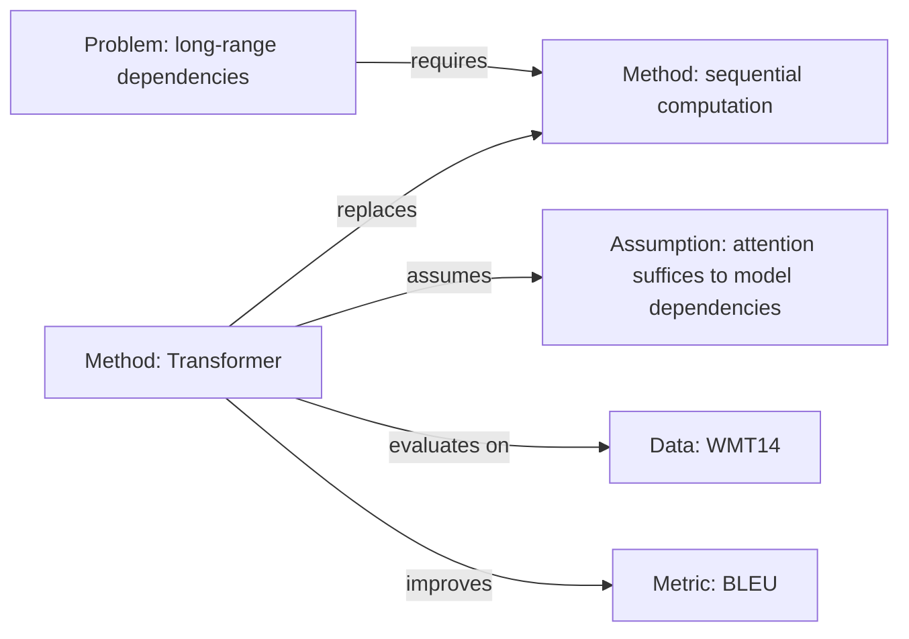

# 03 Multi-Paper Comparison, Synthesis and Research Gaps

> Use for: side-by-side comparison of ≥3 papers on the same topic, literature review notes, gap analysis before choosing a topic, concept maps and citation chains.
> Prerequisite: each paper already has an L1 or L2 note. **Do not build a matrix or a synthesis directly from abstracts** — that only juxtaposes abstracts incorrectly.

## 1. Workflow

1. **Define scope**: topic, problem, time window, literature type (journal/conference/preprint); write it at the start of the synthesis.
2. **Build an index**: `notes/index.md`, one line per paper. Suggested columns:

   | paper_id | Year | Problem (≤20 words) | Method family | Key result | Relevance (1–5) | Status |
   |----------|------|---------------------|---------------|------------|-----------------|--------|
   | [{{paper_id}}]({{paper_id}}.md) | | | | | | unread/reading/read |

3. **Check comparability**: same task? same metric? same data split? same budget? Mark non-comparable items "not comparable" and explain why.
4. **Generate the matrix**: `python <skill-dir>/scripts/build_matrix.py notes/ -o notes/matrix.md --csv notes/matrix.csv`.
5. **Add columns manually**: Delta, evidence quality, relevance, notes.
6. **Write the synthesis**: follow the five-part structure in section 5.
7. **Propose gaps**: use the four categories in section 6, three elements per gap.
8. **Link back to the notes**: tag every judgment with `[paper_id]` or a link.

## 2. Comparability Checklist

Confirm each item before comparing; note any difference below the matrix, otherwise readers will compare non-comparable numbers side by side.

- [ ] Same task definition (input/output/evaluation target)
- [ ] Same metric definition and computation (same BLEU implementation? same F1 macro/micro average?)
- [ ] Same dataset and splits (same version, same preprocessing, same train/val/test)
- [ ] Comparable training budget (data size, model size, compute, tuning effort)
- [ ] Same baseline setting (were all papers compared against the same strong baseline?)
- [ ] Same evaluation protocol (beam size, post-processing, number of runs)

## 3. Comparison Matrix Fields

| Field | Source | Rule |
|-------|--------|------|
| `Paper` | automatic | `paper_id`, linked to the note |
| `Title` | automatic | original title |
| `Year` / `Venue` | automatic | mark preprints as arXiv |
| `Problem` | automatic | from the quick-read "problem", ≤40 words |
| `Method` | automatic | from the quick-read "approach"; write the mechanism, not the model name |
| `Key result` | automatic | from the quick-read "result", with numbers and dataset |
| `Level` / `Tags` | automatic | reading level and tags |
| **Delta** | manual | difference from the strongest baseline (state relative/absolute, metric, dataset) |
| **Evidence quality** | manual | strong/medium/weak + one-sentence reason (seeds, baselines, statistics) |
| **Relevance** | manual | 1–5, relevance to the reader's research |
| **Note link** | automatic | path to the note file |
| **Note** | manual | one-line remark (reproducibility/concerns) |

**How to write non-comparable cells**: `—` (not applicable) or `not comparable: different metric definition`; **never** put numbers from different datasets in the same column.

## 4. Reading the Matrix (from Table to Insight)

1. **Group by method family**: compare increments within a family, paradigms across families.
2. **Find outliers**: for results that are much higher/lower, ask what differs in the setup (data, budget, metric).
3. **Find "same question, different answers"**: conflicting conclusions on the same problem → a high-value point of controversy.
4. **Find empty columns**: many "not reported" on a dimension → an evidence gap.
5. **Look at time trends**: how method families migrate across years, how metrics saturate.

## 5. Synthesis Note Structure (five parts)

Use `templates/synthesis.md`; each part requires:

### 5.1 Problem genealogy

How the problem evolved: original definition → key turning point (which paper changed the setting) → current mainstream definition.
Format: `The problem evolved from A [paper1] to B [paper2,3]; the turning point was ...`

### 5.2 Method families and consensus

Split into 2–4 families by mechanism; for each write: core idea, representative work, conditions of applicability, shared weaknesses.
**Consensus** = ≥2 independent papers reaching same-direction evidence under comparable settings. Write it as a table:

| Consensus | Supporting evidence | Counterexample/boundary |
|-----------|---------------------|-------------------------|
| | `[paper_id, locator]` | |

### 5.3 Disagreements and their causes

For each disagreement write: the point of dispute, evidence on both sides, possible causes (data/setting/metric/assumption), and how to adjudicate it.
Format: `A argues X [p1], B reports the opposite [p2]; the difference may come from ...; it can be adjudicated with ... experiments.`

### 5.4 Trends

- Method trends: which assumptions were abandoned/kept?
- Evidence trends: are datasets larger? have metrics changed? is variance now reported?
- Application trends: from benchmarks toward real scenarios?

### 5.5 Gaps and opportunities

Continue in section 6; for each gap state "why there is a window of opportunity to do it now".

**Prohibited in synthesis writing**:
- Do not write "most studies believe" — unless you give the count (`5 of 8 papers`).
- Do not write "works better" — give numbers and settings.
- Do not turn a single-paper finding into consensus.
- Do not introduce literature you have not read.

## 6. Four Categories of Research Gaps

| Type | Definition | Criteria (all must hold) | Pseudo-gap (do not write) |
|------|------------|-------------------------|---------------------------|
| **Problem gap** | under a new scenario/constraint the original problem does not hold or is undefined | the new setting really exists + current methods do not cover it + a measurable success criterion exists | "no one has studied this dataset yet" |
| **Method gap** | the assumptions of current methods fail in the target scenario and there is no substitute | the failing assumption is named + evidence exists + a feasible alternative direction exists | "combine A and B" (with no mechanistic reason) |
| **Evidence gap** | the conclusion lacks key evidence (baseline/scale/negative results/statistics) | the evidence is necessary for the conclusion + current papers lack it + it can be obtained experimentally | "run a few more datasets" (no hypothesis) |
| **Application gap** | deployment constraints (cost/latency/privacy/data) are not considered by the method | the constraint is real + it affects usability + it can be quantified | "not productized" |

**Every gap must have three elements**:

1. **Evidence**: the specific result or absence in `[paper_id §x]`.
2. **Why it is unresolved**: technical obstacle / data obstacle / evaluation obstacle / cognitive blind spot (give reasons, do not speculate).
3. **Verifiable next step**: an experiment that can falsify, or a deliverable (dataset, metric, baseline).

**Gap writing template**:

```text
Under <setting S>, method family M relies on assumption A [p1 §3][p2 §4.2].
When A fails (<evidence>), existing work does not report <result/method>.
Gap type: <problem/method/evidence/application>.
Verifiable next step: <experiment design + expected result + falsification condition>.
```

## 7. Concept Map (Capability 7)

- **Node types**: task, method, dataset, metric, assumption, phenomenon.
- **Edge types**: `improves`, `replaces`, `combines`, `evaluates on`, `assumes`, `contradicts`, `extends`.
- **Rules**: every edge needs a source (paper locator or note link); the graph should not exceed ~20 nodes, otherwise split it.
- Output Mermaid (renderable) or node/edge tables (loadable into a database).



## 8. Citation Chain and Related Literature (Capability 11)

### 8.1 Record format

| Literature | Relation | Why it matters | Difference from this paper | Reliability |
|------------|----------|----------------|----------------------------|-------------|
| `author-year` | predecessor/competitor/follow-up | one sentence | one sentence | peer-reviewed/preprint/blog |

### 8.2 Directions

- **backward** (cited by this paper): find foundational work, direct predecessors, and work this paper criticizes.
- **forward** (citing this paper): find follow-up improvements, reproductions/refutations, applications.

### 8.3 Tools and reliability

- Semantic Scholar / Connected Papers / Google Scholar / OpenAlex can query citation relations.
- Reliability: peer-reviewed > preprint > technical report > blog; citation counts are only a reference.
- **When offline**: mark the citation chain "unverified"; do not write specific citation counts/impact factors.

## 9. Copyable Prompts

```text
Build a comparison matrix for these papers with columns: Paper, Year, Venue, Problem,
Assumption, Dataset, Method family, Key idea, Metric, Result, Strongest baseline, Delta,
Cost, Evidence quality, Reproducibility, Relevance (1–5). Mark incomparable cells as "—"
and explain metric/setting differences below the table.
```

```text
Synthesize the following papers into a structured literature review note summarizing
common themes, major differences, open problems, and future directions. Cite paper ids for
every judgment; distinguish consensus (≥2 independent papers) from single-paper findings.
```

```text
Based on these papers, identify open problems: problem gaps, method gaps, evidence gaps,
and application gaps. For each: supporting evidence (paper + locator), why unresolved,
and a falsifiable next step.
```
