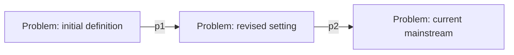

# {{topic}} — Literature Synthesis Note

> Scope: {{problem/topic}} | Included papers: {{N}} | Time window: {{YYYY–YYYY}} | Updated: {{YYYY-MM-DD}}
> Prerequisite: each paper already has an L1/L2 note; every judgement in this note must be linkable back to a `paper_id`.

## 0. One-sentence Conclusion

{{Where the field stands now, the largest consensus, and the largest gap}} [Inference]

## 1. Problem Lineage

{{How the problem was first defined [p1]; which work changed the setting [p2]; what the current mainstream definition is [p3,p4]}}

## 2. Method Families and Consensus

| Method family | Core idea | Representative work | Applicable conditions | Common weakness |
|---------------|-----------|--------------------|-----------------------|-----------------|
| {{A}} | {{}} | {{[p1][p2]}} | {{}} | {{}} |
| {{B}} | {{}} | {{[p3]}} | {{}} | {{}} |

| Consensus | Supporting evidence (≥2 independent) | Boundaries / counterexamples |
|-----------|--------------------------------------|------------------------------|
| {{}} | {{[p1 §x][p2 Table y]}} | {{}} |

## 3. Disagreements and Causes

| Point of disagreement | Evidence on one side | Evidence on the other side | Possible cause | How to adjudicate |
|-----------------------|----------------------|----------------------------|----------------|-------------------|
| {{}} | {{[p1]}} | {{[p2]}} | {{data/setting/metric/assumption}} | {{experimental design}} |

## 4. Trends

- **Method trends**: {{which assumptions have been abandoned/retained}}
- **Evidence trends**: {{changes in dataset size, metrics, statistical reporting}}
- **Application trends**: {{the shift from benchmarks to real scenarios}}
- **Timeline**: {{3–5 key milestones}}

## 5. Research Gaps and Opportunities

| Type | Gap | Evidence | Why it is unsolved | Verifiable next step |
|------|-----|----------|--------------------|----------------------|
| problem/method/evidence/application | {{}} | {{[p1][p2]}} | {{}} | {{}} |

**Why now**: {{what changed in technology/data/evaluation conditions that makes this gap actionable}}

## 6. Implications for My Research

- **Directly reusable**: {{methods/data/metrics}}
- **Pitfalls to avoid**: {{...}}
- **First experiment to run**: {{hypothesis + data + metric + expectation + falsification conditions}}

## 7. Included Literature

| # | Paper | Year | Method family | Evidence level | Note |
|---|-------|------|---------------|----------------|------|
| 1 | {{}} | {{}} | {{}} | A/B/C | [{{paper_id}}]({{paper_id}}.md) |

## 8. Update Log

| Date | Change |
|------|--------|
| {{YYYY-MM-DD}} | First draft: {{N}} papers included |
