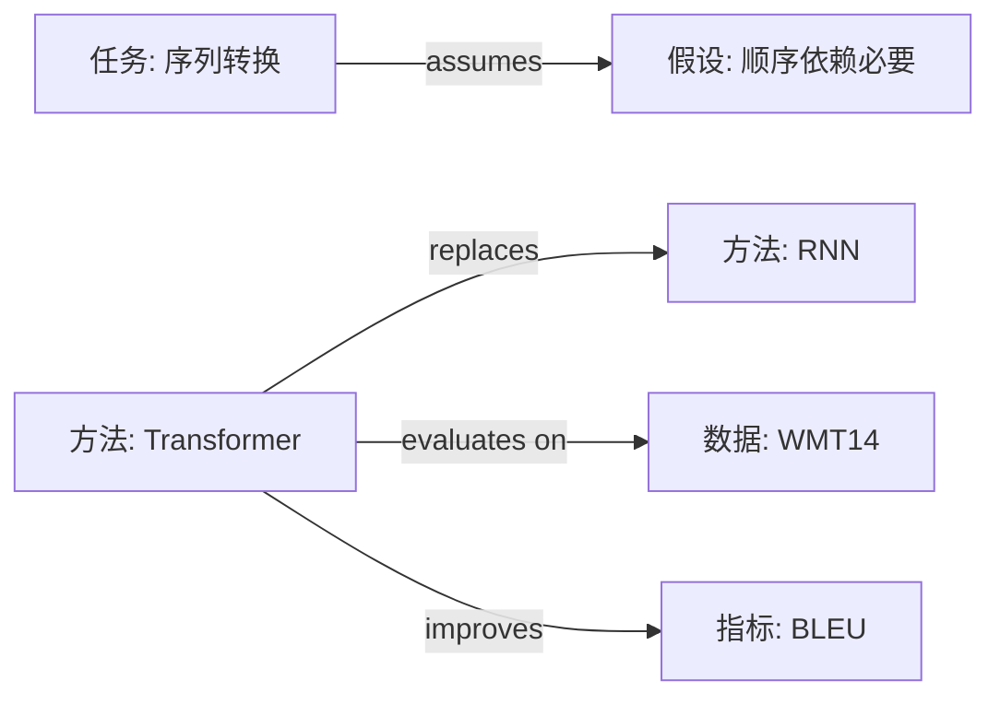

# 01　抽取提示词与提问清单

> 用法：阅读时按"逐节提问"推进；每个抽取结果写成 `结论 | 数值 | 定位符 | 标签` 四元组。
> 本文件也是介绍中 12 项能力的可复制提示词库，按需取用，不必每次全读。

## 一、通用抽取约定

1. **先定位再抽取**：读到一个论断，先记它在哪（`§` / `p.` / `Table` / `Fig` / `Eq.` / `L`），再写内容。
2. **一条一行**：抽取表一行只放一个事实/判断，避免长段落。
3. **数值原样**：抄原文精度；相对提升与绝对提升分开；单位、数据集、指标都写全。
4. **不确定就标**：看不清/读不到的内容写 `[疑问]` 或"未报告"，不要用常识补。
5. **区分事实与解释**：`[原文]` 是论文写了；`[推断]` 是我从证据推的；`[外部: 来源]` 是论文之外的。
6. **公式编号闭环**：引用 `Eq. (x)`/附录式编号前，先确认该公式已在笔记中出现；未出现则就地补写公式，范围引用只保留已展示的编号。
7. **推导语体与语病**：推导用论文式陈述（设/令/由…得/于是/故），不写教学式分步编号与元话语；写完后逐句检查主语、搭配、赘余、逻辑重复、指代。
8. **领域导读**：动笔写正文前，先用 3 个问题把领域讲清：这个领域研究什么、分几层问题、本文补哪一层；写成 §0 前的 2–3 段导读，可配自绘示意图。
9. **推导不跳步**：写推导时给出所依据的原始公式，并说明做了什么操作（代入/展开/平均/积分/极限）；移项、合并同类项等基础代数不必展开，但"由 X 得 Y"必须交代依据。
10. **起始式标注来源**：给出初始表达式时写明性质——定义、公认事实/守恒律、前文结论（Eq. x），还是论文假设；复合式先给最简情形（如自由运行），再说明新增项（如 $+\Delta f$）为何加入。
11. **关键判断给机制**："唯有/必然/等价/只有…稳定"类判断，给 1–3 式最小机制 + 一句口语直觉 + 边界；不写完整证明，也不只下结论。线性化要写出 Taylor 展开（一阶项 + 余项）。
12. **读者标记与附录 1**：读者用 `<u>术语</u>$^{[n]}$` 标出不懂的名词，表示要 Agent 在附录 1 解释；保留标记与编号，在文末按编号逐条写"定义 + 作用 + 区别"，每条 2–4 句。

## 二、逐节提问清单

### 2.1 标题与摘要

**问什么**
- 研究问题是什么？在什么任务/场景下？
- 核心做法的一句话描述是什么（不是模型名）？
- 关键结果的具体数值、数据集、对比对象是什么？
- 作者声称的贡献有哪几条？每条是否有后文证据？

**读到什么算够**
- 能用三句话复述"问题—做法—结果"，其中结果带数值。
- 能列出 2–5 条贡献，并标出哪条是"新问题/新方法/新证据"。

**糊弄信号**
- 摘要只有形容词没有数值（"显著优于"但无数字）→ 去正文 Table 找。
- 贡献列表与实验章节对不上（声称的贡献没有对应实验）。

### 2.2 引言

**问什么**
- 领域现状的 2–3 句概括是什么？作者认为的具体痛点是什么（不是"效果不够好"）？
- 现有方法为什么不够？作者归因到哪个机制/假设？
- 本文的关键洞察（key insight）是什么？它为什么能绕开前面的痛点？
- 贡献列表逐条核对：对应哪节/哪个表？

**读到什么算够**
- 能写出一句"作者认为现有方法的根因是 X，因此改用 Y"。
- 每条贡献能指到后文位置（或标注"未找到对应证据"）。

**糊弄信号**
- 只有"近年来 X 受到广泛关注"式背景，没有具体痛点。
- 贡献是"提出一个框架/做了大量实验/取得好结果"这类空话。

### 2.3 相关工作

**问什么**
- 作者把已有工作分成哪几类？分类标准是什么？
- 与本文最接近的 2–4 篇是谁？差在哪（问题/假设/方法/数据/指标）？
- 有没有明显该引未引的工作？（结合自己已知文献判断）

**读到什么算够**
- 能画出"方法族—代表工作—本文位置"的小表。
- 能说出本文相对最接近工作的 2 条实质差异。

**糊弄信号**
- 只罗列不比较；"据我们所知首次"但没有检索依据。

### 2.4 方法

**问什么**
- 输入、输出、监督信号分别是什么？形式化定义（符号）是什么？
- 整体架构分几个模块？模块间数据流是什么？
- 每个关键模块解决什么问题？如果用消融去掉会怎样？
- 关键公式/算法：目标函数、更新规则、约束、近似假设；逐条写清公式含义、符号、思想来源/动机、作用、成立条件。
- 每个公式的完整推导：从"推导动机/思想来源"出发，每一步用了哪条假设、为什么能到目标式；推导写清后，表格里的动机/来源可精简成一句话。
- 公式之间如何串联：哪一式是起点、哪一式由哪一式推出、每一式解决了上一式留下的什么问题、为什么不能跳过中间步骤。
- 换一条推导路线：作者本可以怎么推、为什么选择现在这条路线，这如何决定公式的最终形态。
- 训练细节：数据、划分、优化器、学习率/调度、batch、epoch/步数、正则化、初始化、算力。
- 复杂度：时间/空间复杂度，随规模如何增长；推理成本。
- 实现细节：代码/数据是否公开？依赖哪些预处理？随机性如何处理？

**读到什么算够**
- 一个熟悉该领域但没读过这篇论文的人，能据此复现主干实验（至少知道缺哪些细节）。
- 能对每个核心公式说出：它算什么、符号是什么、作者为什么这样写、去掉或改动会怎样。
- 能画出公式链：从哪个假设/定义出发，经过哪些公式，最终得到什么结论；每一步为什么不能省。
- 能按"动机/来源 → 中间步 → 目标式"复述每个核心公式的完整推导，而不只是解释公式本身。
- 能指出方法依赖的 1–2 个强假设，并说明假设不成立时会怎样。

**糊弄信号**
- 方法只写"提出了 X 模块"，没有输入输出与公式。
- 公式只有结论、没有推导链；或用"显然/易得"跳过关键一步。
- 超参、数据划分、seed、算力缺失且未说明。

### 2.5 实验与结果

**问什么**
- 数据集：规模、划分、预处理、是否有泄漏风险？
- 基线：选了谁？是否是强基线？是否同数据/同预算/同调参力度？
- 指标：定义、方向、是否与结论匹配？有没有更合适的指标被回避？
- 主结果：每个数据集/设置的最好数值、最强基线数值、差值（相对/绝对）。
- 消融：删了哪个模块、影响多少？是否覆盖关键设计？
- 鲁棒性/显著性：多种子、误差棒、置信区间、显著性检验、失败案例。
- 计算成本：训练/推理成本与基线的对比是否公平。

**读到什么算够**
- 能填出一张"数据集 × 方法 × 指标"的主结果表（至少 2 个数据集或 2 个指标）。
- 能指出至少 1 个"结果很强但证据不足"的点。

**糊弄信号**
- 只报最好结果，不报方差/种子数。
- 基线是多年前的弱方法，或未调参。
- 消融只删一个模块，或所有变体都优于基线（可疑）。
- 指标定义与任务目标不一致（如类别不平衡只看 accuracy）。

### 2.6 讨论与结论

**问什么**
- 作者承认的局限有哪些？是否给出证据？
- 作者没承认但你能看出的局限有哪些？
- 结论的适用范围是什么？作者是否外推过远？
- 未来工作是什么？哪些是真正可做的？

**读到什么算够**
- 能区分"作者承认的局限"与"我发现的局限"，各 ≥1 条。

### 2.7 附录

**问什么**
- 补充实验是否改变主结论？
- 超参搜索范围、额外数据集、证明、失败案例。
- 附录里的实现细节是否补全了正文缺失。

**读到什么算够**
- 至少扫一遍附录标题；与主结论相关的附录要读。

## 三、四张抽取表（可直接复制到笔记草稿）

### 表 A：问题表

| 项 | 内容 | 定位 |
|----|------|------|
| 输入 | | |
| 输出 | | |
| 关键假设 | | |
| 约束条件 | | |
| 失败模式 | | |
| 与已有定义的区别 | | |
| 成功标准（作者如何算解决） | | |

### 表 B：方法表

| 项 | 内容 | 定位 |
|----|------|------|
| 整体架构 | | |
| 模块 1：作用/输入输出 | | |
| 关键公式/算法 | |
| 公式含义/符号/思想来源 | | |
| 损失函数 | | |
| 训练流程与超参 | | |
| 复杂度（时间/空间） | | |
| 实现细节（代码/数据/预处理） | | |
| 强假设与失效条件 | | |

### 表 C：证据表

| 数据集 | 规模/划分 | 指标 | 本文结果 | 最强基线 | 差值 | 定位 |
|--------|-----------|------|----------|----------|------|------|
| | | | | | | |

| 消融/鲁棒性实验 | 删改什么 | 影响 | 定位 |
|------------------|----------|------|------|
| | | | |

| 统计信息 | 内容 | 定位 |
|----------|------|------|
| 种子数/方差/置信区间 | | |
| 显著性检验 | | |
| 失败案例 | | |
| 计算成本 | | |

### 表 D：结论表

| 作者声称 | 证据支持程度 | 我的判断 |
|----------|--------------|----------|
| | 强/中/弱 + 理由 | |

## 四、12 项能力的可复制提示词

### 1. Metadata Extractor

```text
Extract paper metadata and standardize into a schema: title, authors, affiliations, venue,
year, doi/url, keywords, problem, dataset, method, contributions, limitations.
Output YAML frontmatter (or JSON when the user asks); mark unknown fields as null.
```

**字段归属**：frontmatter 只放书目/管理字段（见 `SKILL.md` 字段表：paper_id、title、authors、venue、
year、doi/url、keywords、reading_level 等）；`problem / dataset / method / contributions /
limitations` 属于内容抽取，写入笔记第 0、2–6 节，不塞进 frontmatter。JSON 只是中间结构化结果，二者不要求字段一一对应。
需要 JSON 时用：

```json
{
  "paper_id": "author2026-topic",
  "title": "",
  "authors": [],
  "affiliations": [],
  "venue": "",
  "year": 0,
  "doi": "",
  "url": "",
  "keywords": [],
  "problem": "",
  "dataset": [],
  "method": "",
  "contributions": [],
  "limitations": [],
  "code_url": "",
  "paper_type": "empirical | theoretical | survey | system"
}
```

### 2. Abstract-to-Claim Summarizer

```text
Read the abstract and extract the core research problem, hypotheses, methods, and results
in exactly 5 bullets, each ≤30 Chinese characters, and quote the key number.
```

中文版：`把摘要改写为 5 条：问题 / 关键假设 / 方法 / 主要发现（带数值）/ 适用边界。`

### 3. Methodology Extractor

```text
Extract the methodology: problem formulation (inputs/outputs/assumptions), architecture,
key equations, training procedure, hyperparameters, data splits, complexity, and
implementation details. First give the derivation chain: which equation is the starting
point, which equation is derived from which, what problem each equation leaves for the next,
and why no intermediate step can be skipped. Then for each key equation explain its meaning,
symbols, derivation motive, origin/motivation, role in the method, and assumptions.
For each item give a section/table locator. Mark missing items as "not reported". Do not infer.
```

### 4. Result-and-Evidence Extractor

```text
From the experiments section, extract: datasets, baselines, metrics, main results,
ablations, variance/significance, failure cases, and compute cost. For every number give
the Table/Figure locator and the exact baseline setting. Flag any claim not supported by a
number.
```

### 5. Critical Appraisal Skill

```text
Assess the paper critically without scores or confidence ratings. First restate the limitations
the authors explicitly acknowledge (paraphrase with locators). Then add further limitations the
authors did not acknowledge: evidence, experimental design, assumptions, external validity,
reproducibility, formulation. For each further limitation give the evidence (locator), its
impact on the conclusions, and how to test it.
```

### 6. Comparison Matrix

```text
Build a comparison matrix for these papers with columns: Paper, Year, Venue, Problem,
Assumption, Dataset, Method family, Key idea, Metric, Result, Strongest baseline, Delta,
Cost, Evidence quality, Reproducibility, Relevance (1–5). Mark incomparable cells as "—"
and explain metric/setting differences below the table.
```

### 7. Concept Mapping / Knowledge Graph

```text
Map the paper's key concepts into a graph: nodes are Task / Method / Dataset / Metric /
Assumption / Phenomenon; edges are "improves", "replaces", "combines", "evaluates on",
"assumes", "contradicts". Every edge must cite a locator in the paper.
```

Mermaid 骨架：



### 8. Research Gap Finder

```text
Based on these papers, identify open problems: (a) problem gaps (new settings/constraints),
(b) method gaps (assumptions that fail), (c) evidence gaps (missing baselines/scale/negative
results), (d) application gaps (deployment constraints). For each gap give: supporting
evidence (paper + locator), why it is unresolved, and a falsifiable next step.
```

### 9. Reading Note Template Generator

本 Skill 的 `templates/` 已提供模板；需要生成新模板时：

```text
Generate a reading-note template for <field> containing: metadata, problem definition,
method (reproducible details and per-formula explanation of meaning/symbols/origin), evidence
table, claimed-vs-supported findings, author-acknowledged limitations followed by further
limitations, relation to my research, research gaps. Do not include scoring or confidence
ratings. For deep notes, add a reproduction plan with runnable Python code.
```

### 10. Personal Reflection / Insight Builder

```text
Connect the paper to my research: (1) what method can be transferred, (2) what data/metric
can be reused, (3) what limitation should I avoid, (4) what is the most important idea,
(5) what is the next experiment I could run. Be concrete; no generic praise.
```

### 11. Citation Graph / Related Work Finder

```text
Identify the paper's most relevant backward and forward citations. For each: why it matters
(predecessor / competitor / follow-up), and what changed. If you cannot verify a citation,
mark it "unverified" — never invent references.
```

### 12. Synthesis & Comparison Agent

```text
Synthesize the following papers into a structured literature review note summarizing
common themes, major differences, open problems, and future directions. Every judgment
must cite which notes support it (paper ids) and distinguish consensus (≥2 independent
papers) from single-paper findings.
```

## 五、不同输入格式的处理

| 输入 | 操作 |
|------|------|
| PDF 双栏 | 先读单栏内文本；跨栏断行处标记，避免拼接错位 |
| 扫描 PDF | 先 OCR；OCR 错误率高的公式/表格标注"未能可靠读取" |
| 公式 | 保留论文编号；抄写关键公式到笔记；符号表放附录 |
| 表格 | 只抄与结论相关的行；注明表号与设置（如"Table 2 右半部分"） |
| LaTeX 源码 | 按 `\section`/`\label` 建定位；`[L行号]` 可用 |
| 网页/HTML | 记录 URL 与访问日期；预印本记录版本 |
| 只有摘要 | 只做 L1；笔记标题加"（仅摘要，未读全文）" |
