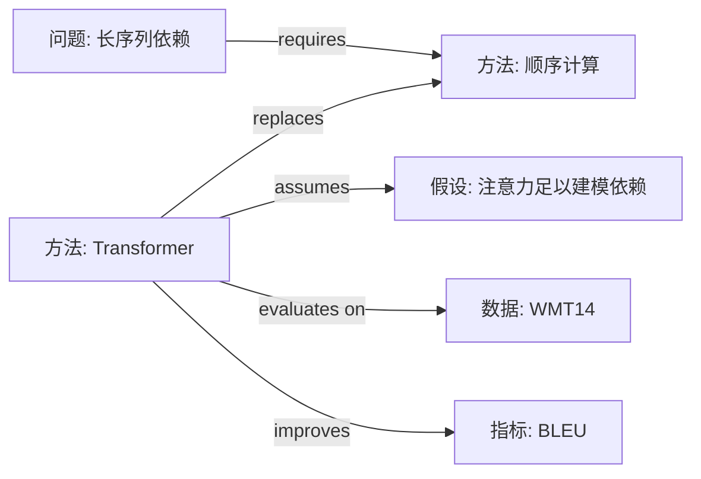

# 03　多篇对比、综述与研究空白

> 用于：≥3 篇同主题论文的横向对比、文献综述笔记、选题前的 gap 分析、概念图与引用链。
> 前提：每篇先有 L1 或 L2 笔记。**不允许直接拿摘要做矩阵或综述**——那只是把摘要错误地并排。

## 一、流程

1. **定范围**：主题、问题、时间窗、文献类型（期刊/会议/预印本），写进综述开头。
2. **建索引**：`notes/index.md`，一行一篇。建议列：

   | paper_id | 年份 | 问题（≤20 字） | 方法族 | 关键结果 | 相关性(1–5) | 状态 |
   |----------|------|----------------|--------|----------|--------------|------|
   | [{{paper_id}}]({{paper_id}}.md) | | | | | | 未读/在读/已读 |

3. **比可比性**：同任务？同指标？同数据划分？同预算？不可比的标"不可比"并说明原因。
4. **生成矩阵**：`python <skill目录>/scripts/build_matrix.py notes/ -o notes/matrix.md --csv notes/matrix.csv`。
5. **人工补列**：Delta、证据质量、相关性、备注。
6. **写综述**：按第五节五段式。
7. **提 gap**：按第六节四分类，每条三要素。
8. **回链笔记**：每个判断标 `[paper_id]` 或链接。

## 二、可比性检查表

对比前逐项确认；任一不同都要在矩阵下方注明，否则读者会把不可比数字并排比较。

- [ ] 任务定义相同（输入/输出/评价对象）
- [ ] 指标定义与计算方式相同（同一 BLEU 实现？同一 F1 宏/微平均？）
- [ ] 数据集与划分相同（同版本、同预处理、同 train/val/test）
- [ ] 训练预算可比（数据量、模型规模、算力、调参力度）
- [ ] 基线设置相同（是否都对比了同一强基线）
- [ ] 评估协议相同（beam size、后处理、多次运行）

## 三、对比矩阵字段

| 字段 | 来源 | 规则 |
|------|------|------|
| `Paper` | 自动 | `paper_id`，链接到笔记 |
| `Title` | 自动 | 原文标题 |
| `Year` / `Venue` | 自动 | 预印本标 arXiv |
| `Problem` | 自动 | 取自速览"问题"，≤40 字 |
| `Method` | 自动 | 取自速览"做法"，写机制不写模型名 |
| `Key result` | 自动 | 取自速览"结果"，带数值与数据集 |
| `Level` / `Tags` | 自动 | 阅读级别与标签 |
| **Delta** | 人工 | 相对最强基线的差值（注明相对/绝对、指标、数据集） |
| **Evidence quality** | 人工 | 强/中/弱 + 一句理由（种子、基线、统计） |
| **Relevance** | 人工 | 1–5，与读者研究的相关度 |
| **Note link** | 自动 | 指向笔记文件 |
| **Note** | 人工 | 一句话备注（可复现性/疑点） |

**不可比写法**：`—`（不适用）或 `不可比：指标定义不同`；**不要**把不同数据集的数字放同一列比较。

## 四、矩阵读法（从表到洞察）

1. **按方法族分组**：同族内比增量，跨族比范式。
2. **找异常值**：显著高/低的结果，追问设置差异（数据、预算、指标）。
3. **找"同题不同答"**：同一问题不同论文结论冲突 → 高价值争议点。
4. **找空白列**：某维度大量"未报告" → 证据空白。
5. **看时间趋势**：方法族随年份如何迁移、指标如何饱和。

## 五、综述笔记结构（五段式）

用 `templates/synthesis.md`，每段要求：

### 5.1 问题谱系

问题如何演化：最初定义 → 关键转折（哪篇改变了设定）→ 当前主流定义。
写法：`问题从 A [paper1] 演化到 B [paper2,3]，转折点是……`

### 5.2 方法族与共识

按机制分 2–4 个族，逐族写：核心思想、代表工作、适用条件、共同弱点。
**共识** = ≥2 篇独立论文、在可比设置下得到同向证据。写成表：

| 共识 | 支持证据 | 反例/边界 |
|------|----------|-----------|
| | `[paper_id, locator]` | |

### 5.3 分歧与原因

每条分歧写：分歧点、双方证据、可能原因（数据/设置/指标/假设）、如何裁决。
写法：`A 认为 X [p1]，B 报告相反 [p2]；差异可能来自……；可用……实验裁决。`

### 5.4 趋势

- 方法趋势：哪些假设被放弃/保留？
- 证据趋势：数据集变大？指标变化？开始报告方差？
- 应用趋势：从 benchmark 走向真实场景？

### 5.5 空白与机会

接第六节；每条 gap 给"为什么现在做有窗口"。

**综述写作禁令**：
- 不写"大多数研究认为"——除非给出计数（`5/8 篇`）。
- 不写"效果更好"——给数值和设置。
- 不把单篇发现写成共识。
- 不引入未读过的文献。

## 六、研究空白（Gap）四分类

| 类型 | 定义 | 判定标准（需同时满足） | 伪 gap（不要写） |
|------|------|------------------------|------------------|
| **问题空白** | 新场景/新约束下原问题不成立或未定义 | 新设定真实存在 + 现有方法未覆盖 + 有可测的成功标准 | "还没人研究过这个数据集" |
| **方法空白** | 现有方法的假设在目标场景失效，且无替代 | 明确指出失效假设 + 有证据 + 有可行替代方向 | "把 A 和 B 组合一下"（无机制理由） |
| **证据空白** | 结论缺关键证据（基线/规模/负结果/统计） | 该证据是结论必需 + 现有论文缺失 + 可实验获得 | "再多跑几个数据集"（无假设） |
| **应用空白** | 落地约束（成本/延迟/隐私/数据）未被方法考虑 | 约束真实 + 影响可用性 + 可量化 | "没做产品化" |

**每条 gap 必须三要素**：

1. **证据**：`[paper_id §x]` 的具体结果或缺失。
2. **为什么没解决**：技术障碍/数据障碍/评估障碍/认知盲区（给出理由，不臆测）。
3. **可验证的下一步**：一个能证伪的实验或可交付物（数据集、指标、基线）。

**Gap 写作模板**：

```text
在 <设定 S> 下，方法族 M 依赖假设 A [p1 §3][p2 §4.2]。
当 A 不成立时（<证据>），现有工作未报告 <结果/方法>。
缺口类型：<问题/方法/证据/应用>。
可验证的下一步：<实验设计 + 预期结果 + 证伪条件>。
```

## 七、概念图（能力 7）

- **节点类型**：任务、方法、数据集、指标、假设、现象。
- **边类型**：`improves`（改进）、`replaces`（替代）、`combines`（组合）、`evaluates on`（评测）、
  `assumes`（依赖假设）、`contradicts`（冲突）、`extends`（扩展）。
- **规则**：每条边要有出处（论文定位符或笔记链接）；图不超过 ~20 个节点，否则拆图。
- 输出 Mermaid（可渲染）或节点/边表（可入库）。



## 八、引用链与相关文献（能力 11）

### 8.1 记录格式

| 文献 | 关系 | 为什么重要 | 与本文差异 | 可靠性 |
|------|------|------------|------------|--------|
| `author-year` | 前作/竞争/后续 | 一句话 | 一句话 | 同行评审/预印本/博客 |

### 8.2 方向

- **backward**（本文引用的）：找奠基工作、直接前作、被本文批判的工作。
- **forward**（引用本文的）：找后续改进、复现/反驳、应用。

### 8.3 工具与可靠性

- Semantic Scholar / Connected Papers / Google Scholar / OpenAlex 可查引用关系。
- 可靠性：同行评审 > 预印本 > 技术报告 > 博客；引用量只作参考。
- **不能联网时**：引用链标"未核查"，不写具体引用数/影响因子。

## 九、可复制提示词

```text
Build a comparison matrix for these papers with columns: Paper, Year, Venue, Problem,
Assumption, Dataset, Method family, Key idea, Metric, Result, Strongest baseline, Delta,
Cost, Evidence quality, Reproducibility, Relevance (1–5). Mark incomparable cells as "—"
and explain metric/setting differences below the table.
```

```text
Synthesize the following papers into a structured literature review note summarizing
common themes, major differences, open problems, and future directions. Cite paper ids for
every judgment; distinguish consensus (≥2 independent papers) from single-paper findings.
```

```text
Based on these papers, identify open problems: problem gaps, method gaps, evidence gaps,
and application gaps. For each: supporting evidence (paper + locator), why unresolved,
and a falsifiable next step.
```
